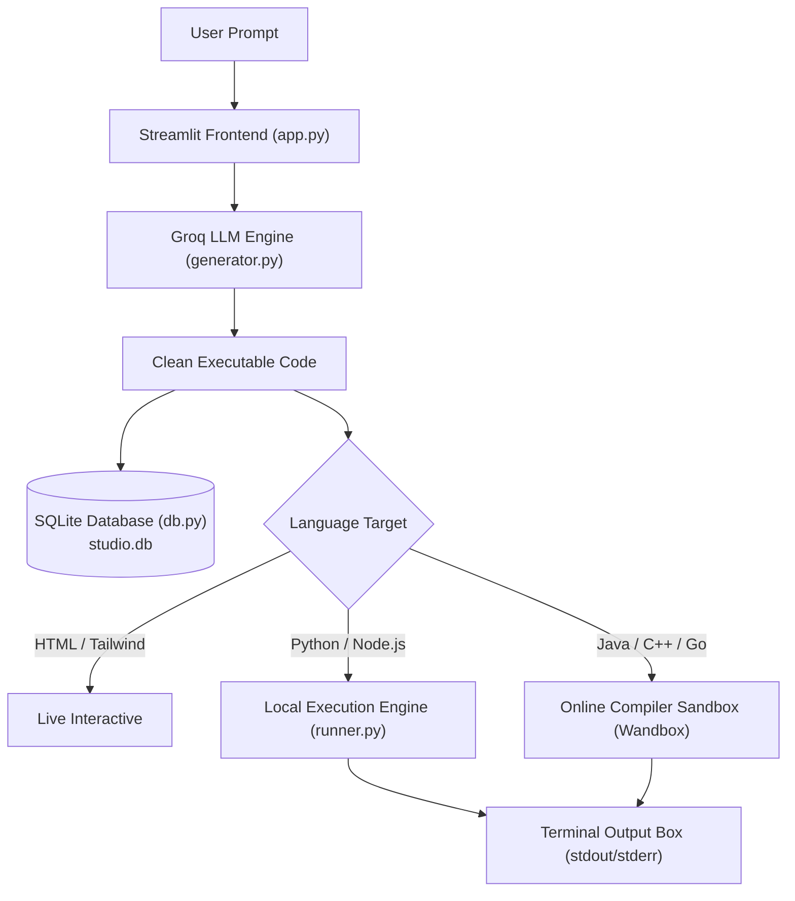

# ⚡ CodeStudio AI — Live Interactive Multi-Language Code & Web Studio

> **Transform Natural Language Prompts into Working Code & Interactive Apps in Seconds.**  
> Powered by Groq LLM, SQLite versioning, and a dual-mode visual & sandbox execution engine.

---

## 🌟 Overview

**CodeStudio AI** is an AI playground designed for rapid prototyping:
1. **Live Web Component Studio**: Generate responsive, single-file HTML5 + Tailwind CSS + JavaScript apps and render them in a live browser iframe.
2. **Multi-Language Runner**: Generate and run **Python**, **Java**, **JavaScript**, **C++**, **Rust**, and **Go** with live console stdout/stderr.
3. **Iterative Refinement**: Chat with AI to mutate existing code (e.g., *"Add dark mode"*, *"Add search filter"*, *"Add unit tests"*), auto-incrementing versions with rollback support.
4. **Persistent Project Vault**: SQLite database tracks projects, snapshots, prompts, and outputs locally.

---

## 🏗️ Architecture



---

## 🚀 Key Features

* **Multi-Language Support**:
  * 🌐 **Web**: HTML5, Tailwind CSS, Canvas, Lucide icons, Chart.js.
  * 🐍 **Python**: Standalone Python 3 scripts with test cases.
  * ☕ **Java**: Standalone Java classes with instant compilation.
  * 🟨 **JavaScript**: Node.js scripts and algorithmic demos.
  * ⚡ **C++ / Go / Rust**: Fast execution with stdout inspection.
* **Dual Execution Modes**:
  * Visual interactive preview for web apps.
  * Real-time dark terminal console with exit codes and execution engine telemetry for backend languages.
* **Snapshot & Version Rollback**:
  * Every AI modification generates a new snapshot (`v1`, `v2`, `v3`).
  * Switch between any past version instantly from the sidebar.
* **Zero Leak Security**:
  * API keys isolated in `.env` (strictly ignored by Git).
  * Safe sample template `.env.example` provided.

---

## 🛠️ Quickstart

### 1. Clone & Navigate
```bash
git clone https://github.com/katsulol/-Live-Interactive-Web-Component-Studio.git
cd -Live-Interactive-Web-Component-Studio
```

### 2. Install Dependencies
```bash
pip install -r requirements.txt
```

### 3. Configure API Key
Create a `.env` file in the root directory:
```env
GROQ_API_KEY=your_groq_api_key_here
```
*(Get a free Groq key at [console.groq.com/keys](https://console.groq.com/keys))*.

### 4. Launch Studio
```bash
streamlit run app.py
```
Open [http://localhost:8501](http://localhost:8501) in your browser.

---

## 📂 Project Structure

```
├── app.py              # Streamlit Web UI (sidebar, tabs, terminal, preview)
├── generator.py        # Groq API client with strict code extraction & refinement
├── runner.py           # Hybrid execution engine (Local Python/Node + Sandbox)
├── db.py               # SQLite storage layer (projects, versions, history)
├── requirements.txt    # Python package dependencies
├── .env.example        # Environment variable template
├── .gitignore          # Prevents committing secrets or databases
└── README.md           # Documentation
```

---

## 📄 License
MIT License.
